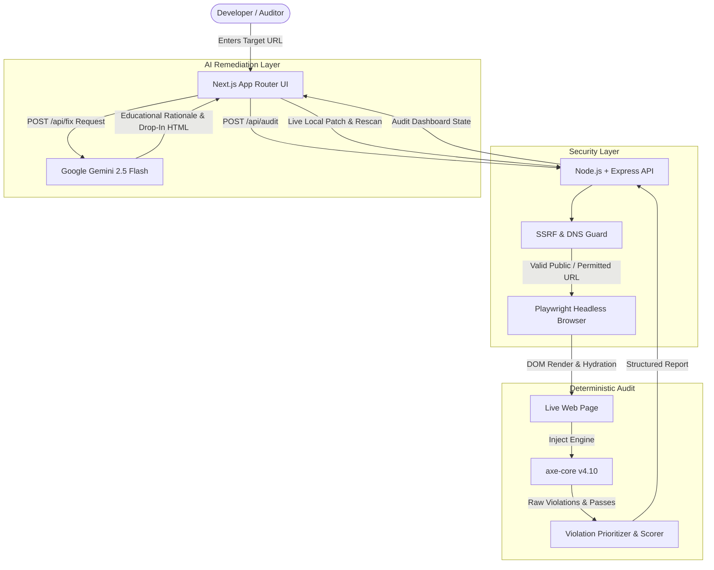

# A11yFix ⚡
### Enterprise-Grade AI-Powered Web Accessibility Auditor & Automated Remediation Engine

[](https://hacktoberfest.com/)
[](https://github.com/dequelabs/axe-core)
[](https://playwright.dev/)
[](https://ai.google.dev/)
[](LICENSE)

> **"AI belongs to everyone."**  
> A11yFix empowers developers, small teams, and public institutions to transform inaccessible web properties into WCAG 2.1 / 2.2 AA compliant experiences in seconds—bridging diagnostic precision with generative intelligence.

---

## 🌟 Overview & Key Capabilities

Most automated accessibility tools stop at generating overwhelming, jargon-heavy error logs without actionable paths to resolution. **A11yFix** fundamentally reimagines accessibility audits:

1. **Deterministic, Real-Browser Engine**:
   - Zero synthetic mocks or hallucinated violations.
   - Headless Chromium powered by **Playwright** renders live DOM, shadow roots, and CSS before executing **Deque axe-core**.
2. **Defensive Security & SSRF Protection**:
   - Multi-tier URL validation with DNS resolution guards against SSRF, internal loopback attacks (RFC 1918), AWS/cloud metadata leakage, and invalid protocols.
3. **Algorithmic Prioritization & Scoring**:
   - Proprietary accessibility scoring (0–100) dynamically calibrated across passes, violation impact weights (`critical` > `serious` > `moderate` > `minor`), and affected node densities.
4. **Targeted AI Remediation via Google Gemini**:
   - Precision prompts transform failing HTML nodes into accessible, drop-in code snippets with plain-English rationales and WCAG criteria references.
5. **Continuous Verification (Rescan & Compare)**:
   - Live before-and-after audit comparison demonstrating tangible score improvements once fixes are applied.
6. **Ultra-Modern 60 FPS Developer UI**:
   - Sleek dark aesthetic with backdrop blur glassmorphism, Framer Motion transitions, responsive drawer mechanics, dynamic circular score gauges, and one-click copy integrations.

---

## 🏗️ Architecture



---

## 🚀 Quickstart & Local Setup

A11yFix is engineered to be **100% self-contained**—no global tools or system-wide binaries required.

### Prerequisites
- **Node.js**: v20+ (tested on Node.js v24)
- **npm**: v10+

### 1. Clone & Configure
```bash
git clone https://github.com/your-username/A11yFix.git
cd A11yFix
```

### 2. Backend Setup
```bash
cd backend
npm install
npm run install:browsers
```

Create `backend/.env`:
```env
PORT=5000
NODE_ENV=development
GEMINI_API_KEY=your_gemini_api_key_here
PLAYWRIGHT_BROWSERS_PATH=./.cache/ms-playwright
ALLOW_LOCALHOST_SCAN=true
SCAN_TIMEOUT_MS=30000
```

### 3. Frontend Setup
```bash
cd ../frontend
npm install
```

### 4. Single-Command Launch (Root Monorepo)
You can start both the backend API server and the Next.js frontend concurrently with a single command from the project root:

```bash
npm run dev
```

- **Frontend:** `http://localhost:3000`
- **Backend API:** `http://localhost:5000`

---

## 📜 License & Compliance
Distributed under the **MIT License**. See `LICENSE` for details.
